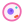

# Assets do LAB

Dono: artista / gerente de assets. Tudo aqui foi desenhado ou escrito pela equipe: nenhum ícone, textura ou código de terceiros.
Regras de origem: guia de estilo, seções 2.3 (paleta científica), 5 (3D) e 6 (ícones e assets).

| O quê | Onde |
|---|---|
| Ícones soltos (SVG) | `site/assets/icons/*.svg` |
| Sprite com todos os ícones | `site/assets/icons/sprite.svg` |
| Página de conferência | `site/assets/icons/preview.html` |
| Gerador dos ícones, sprite e prévia | `site/assets/fonte/gerar-icones.py` |
| Biblioteca de materiais 3D | `site/assets/materials.js` |
| Capturas de conferência | `prints/assets/icones.png`, `prints/assets/materiais.png` (pasta do projeto) |

Origem e licença: todos são criação da equipe do LAB, mesma licença do site. As fontes (Atkinson Hyperlegible Next, Space Grotesk, JetBrains Mono) aparecem só na página de conferência, carregadas do sistema. Nenhum arquivo de fonte foi incluído aqui.

---

## 1. Ícones

Grade de 24 × 24 (`viewBox="0 0 24 24"`), área útil de 20 × 20, traço de 1,75 px, pontas e cantos redondos, sem `width`/`height` fixos e com `<title>` em pt-BR. Conferidos em 16, 20, 24 e 48 px.

O `id` do símbolo no sprite é igual ao nome do arquivo, sem o `.svg`. Os prefixos separam os grupos: `cel-` (tipo de célula), `mod-` (módulo) e `ui-` (ferramenta).

### 1.1 Tipos de célula (coloridos)

Usam as cores da paleta científica, para que a cor do ícone seja a mesma do 3D. A cor está escrita no SVG, então eles **não** herdam `currentColor`. Use só sobre fundo escuro (`--bg`, `--panel`, `--panel-2`): creme e azul-gelo somem no fundo claro.

| Nome | Arquivo / id | Uso | Cores |
|---|---|---|---|
| Célula vegetal | `cel-vegetal` | Seletor de tipo do módulo Célula | parede `#A9C54A`, vacúolo `#2A9FC9`, núcleo `#9A6BFF`, cloroplasto `#3FBF6A` |
| Célula animal | `cel-animal` | idem | membrana `#F06AAE`, núcleo `#9A6BFF` e nucléolo `#6A45D8`, mitocôndria `#F25C3B`, lisossomo `#2FCFBF` |
| Bactéria | `cel-bacteria` | idem | parede (peptidoglicano) `#A9C54A`, nucleoide `#9A6BFF`, ribossomos `#FFE1A6`, flagelo `#CFE0FF` |
| Neurônio | `cel-neuronio` | idem | membrana e bainha de mielina `#F06AAE`, núcleo `#9A6BFF` |
| Espermatozoide | `cel-esperma` | idem | membrana `#F06AAE`, núcleo `#9A6BFF`, acrossomo `#F7C13B`, peça intermediária (mitocôndrias) `#F25C3B`, cauda `#CFE0FF` |
| Levedura | `cel-levedura` | idem | parede `#A9C54A`, vacúolo `#2A9FC9`, núcleo `#9A6BFF` |
| Células do sangue | `cel-sangue` | idem | hemácia `#D7303B` (cor real) com centro `#8E1A24`, leucócito: membrana `#F06AAE` e núcleo lobado `#9A6BFF`, plaqueta `#FFE1A6` |
| Bacteriófago | `cel-fago` | idem | capsídeo e cauda `#B9C2D3` (vírus: cinza-prata, para não parecer célula), DNA `#9A6BFF` |

Observação: o guia (seção 6) pede, para o seletor de tipos, miniaturas renderizadas do nosso modelo 3D (WebP 80 e 120 px). Estes SVG são a versão desenhada: servem para chip, aba, lista e qualquer lugar pequeno (até 24 px), e de reserva enquanto as miniaturas não existem.

### 1.2 Módulos (`currentColor`)

| Nome | Arquivo / id | Uso | Desenho |
|---|---|---|---|
| DNA | `mod-dna` | Aba e cartão do módulo 01 | dupla hélice com três pares de bases |
| Tabela periódica | `mod-tabela-periodica` | Módulo 02 | contorno da tabela, com um elemento marcado e a faixa dos lantanídeos |
| Moléculas | `mod-moleculas` | Módulo 03 | bola e vareta (molécula angular, como a da água) |
| Biomoléculas | `mod-biomoleculas` | Módulo 04 | dois anéis ligados (dois monossacarídeos: a ideia de monômero que forma polímero) |
| Célula | `mod-celula` | Módulo 05 | célula com núcleo, nucléolo, organela e ribossomo |
| Morfofisiologia celular | `mod-morfofisiologia` | Módulo 06 | trecho de membrana com um canal e uma seta atravessando (transporte) |

### 1.3 Ferramentas da barra (`currentColor`)

| Nome | Arquivo / id | Botão (texto do guia) |
|---|---|---|
| Mostrar nomes | `ui-rotulos` | Liga e desliga os rótulos. Desenho: a própria pastilha de rótulo, com ponto de cor e linha-guia |
| Aproximar | `ui-aproximar` | Lupa com + |
| Afastar | `ui-afastar` | Lupa com − |
| Voltar à vista inicial | `ui-reiniciar` | Seta circular em volta de um ponto (a vista) |
| Pausar | `ui-pausar` | Pausa animação de processo |
| Continuar | `ui-continuar` | Toca de novo (o "tocar" do guia) |
| Começar o passeio | `ui-tour` | Três paradas ligadas, a primeira preenchida |
| Voltar | `ui-voltar` | Chevron para a esquerda. Vai com o texto "Voltar à célula inteira" |
| Fechar | `ui-fechar` | Extra, da lista do guia |
| Informação | `ui-informacao` | Extra, da lista do guia |
| No ENEM | `ui-enem` | Extra, da lista do guia: folha de prova com item marcado, para o espaço "No ENEM" do painel |

Estados: o ícone herda a cor do botão. Inativo `--dim`, normal `--txt`, escolhido texto `#1A1206` sobre `--amber`. Na versão clara, `#141A2B`. A página de conferência mostra os quatro.

---

## 2. Como usar o sprite

O sprite é um `<svg>` escondido com um `<symbol>` por ícone.

**Jeito recomendado: colar o sprite no HTML** (logo depois de `<body>`). Funciona também abrindo o site direto do disco (`file://`), onde o navegador bloqueia `<use>` apontando para outro arquivo.

```html
<button class="tool" aria-label="Aproximar">
  <svg class="ico" aria-hidden="true"><use href="#ui-aproximar"/></svg>
</button>
```

```css
.ico { width: 20px; height: 20px; flex: none; }   /* 24px nas abas grandes */
```

**Arquivo externo** (só com o site servido por http/https):

```html
<svg class="ico" aria-hidden="true"><use href="../assets/icons/sprite.svg#ui-aproximar"/></svg>
```

**Arquivo solto como imagem**: serve para os ícones `cel-` (têm cor própria). Para `mod-` e `ui-`, `` não herda `currentColor` e o traço fica preto: use o sprite.

```html

```

Acessibilidade: o botão leva o nome (`aria-label` ou texto visível) e o `<svg>` leva `aria-hidden="true"`. O `<title>` de cada ícone é para quem abre o arquivo sozinho.

**Trocar os ícones atuais do módulo Célula** (objeto `ICONS`, grade 20 × 20): basta trocar o miolo por `<use href="#cel-${k}"/>` e o `viewBox` para `0 0 24 24`. Os nomes dos tipos são os mesmos (`vegetal`, `animal`, `bacteria`, `neuronio`, `esperma`, `levedura`, `sangue`, `fago`).

---

## 3. Materiais 3D (`site/assets/materials.js`)

```html
<script src="../assets/materials.js"></script>
<script>
  const MAT = window.LAB_MATERIALS(THREE);    // THREE do vendor/r3f.js (three 0.187)
</script>
```

Toda fábrica recebe a cor da família por parâmetro. As cores estão em `MAT.CORES` (paleta da seção 2.3, mais `cpk` e `bases`).

| Fábrica | Para quê | Parâmetros-chave |
|---|---|---|
| `membrana(cor, {leve})` | Membrana plasmática, envelope, parede vista por fora | Modo vidro: `transmission` 0,6, `roughness` 0,3, `ior` 1,4. Modo `leve: true`: `opacity` 0,45, `roughness` 0,45 (celular, muitas camadas). Sempre com `sheen` na cor clareada, frente e verso, sem escrever profundidade |
| `borda(cor, intensidade, potencia)` | Brilho de borda (Fresnel) por cima da membrana | Shader nosso, aditivo, respeita planos de corte e instâncias. Intensidade 0,6 a 1,2; potência 2 (larga) a 4 (fina) |
| `organela(cor, {relevo, repetir})` | Núcleo, mitocôndria, Golgi, retículo... | Fosca: `roughness` 0,65, `metalness` 0, `clearcoat` 0, `sheen` 0,35 (cera). Relevo por mapa de normal feito por ruído (força 0,22) |
| `vidro(tom)` | Vacúolo, capsídeo, vesícula com líquido | `transmission` 1, `roughness` 0,18, `ior` 1,33 (água), tom na espessura por `attenuationColor` |
| `pelicula(cor, opacidade)` | Estrutura translúcida dentro de outra | Só opacidade (barato) |
| `citoplasma()` | O recheio | Ameixa `#2A1E3D` a 28% |
| `corte(cor, {escurecer})` | Face cortada | Cor × 0,62, `roughness` 0,9, `polygonOffset` contra tremido |
| `atomo('C')`, `base('A')` | Moléculas (CPK) e DNA | Liso, um pouco mais brilhante que organela |
| `halo()` | Contorno branco de seleção | `borda` branca por trás (`BackSide`), numa cópia da malha com escala 1,04 a 1,07 |
| `selecionar(m, ligado)` | Realce leve da peça escolhida | `emissiveIntensity` 0,18 na própria cor |
| `dessaturar(m, 0.4)` / `restaurar(m)` | As outras peças perdem 40% de saturação | Usa a cor original guardada em `userData.cor0` |
| `luzes(escala)` | As três luzes do guia num `Group` | Principal `#FFF4E6` de cima/esquerda, preenchimento `#CFE0FF` a 30%, contorno branca por trás, hemisfério fraco |
| `fundoPalco(fov)` | Degradê do palco como malha | Necessário quando há `vidro`: o passe de transmissão do three.js não enxerga `scene.background` |
| `configurarRenderer(gl)` | ACES Filmic, exposição 1, saída sRGB | |
| `liberar()` | Descarta o mapa de relevo compartilhado | Chamar ao sair do módulo |

Exemplo, membrana com borda e uma organela selecionada:

```js
const geo = new THREE.SphereGeometry(1, 64, 48);
const cel = new THREE.Mesh(geo, MAT.membrana(MAT.CORES.membrana));
const brilho = new THREE.Mesh(geo, MAT.borda(MAT.CORES.membrana));
brilho.scale.setScalar(1.005);
const mito = new THREE.Mesh(capsula, MAT.organela(MAT.CORES.mitocondria));
// ao escolher a mitocôndria:
todas.forEach(m => m === mito.material ? MAT.selecionar(m) : MAT.dessaturar(m, .4));
```

Comparação com os materiais atuais do módulo Célula (`M`, `GLASS`, `FILM`, `RIM`): `M` usa `roughness` 0,42 e `clearcoat` 0,55, o que dá cara de plástico. `organela` sobe a rugosidade para 0,65, tira o verniz e põe relevo. `GLASS` corresponde a `vidro`, `FILM` a `pelicula` e `RIM` a `borda` (que agora também funciona com corte e instâncias).

Conferido numa cena de teste (three 0.187, Chromium): veja `prints/assets/materiais.png`. Linha de cima: membrana em modo vidro, membrana leve com núcleo dentro, vacúolo e capsídeo (com barras atrás, para ver a transmissão), mitocôndria com halo, cloroplasto em corte. Linha de baixo: retículo, Golgi selecionado, lisossomo, núcleo dessaturado, parede, ribossomo.

---

## 4. Regras para novos assets

1. **Feito por nós.** Nada copiado de bibliotecas de ícones, bancos de imagem ou da referência. Registre cada asset novo nesta página (nome, arquivo, uso, cores, origem).
2. **Ícone de interface:** `viewBox="0 0 24 24"`, conteúdo entre 2 e 22, `stroke-width="1.75"`, `stroke-linecap` e `stroke-linejoin` `round`, `fill="none"`, cor `currentColor`. Detalhe pequeno (ponto, núcleo) pode ser preenchido. Sem perspectiva, sombra, degradê, `width`/`height` ou `style`. Com `<title>` em pt-BR.
3. **Ícone de estrutura biológica:** mesma grade e traço, mas a cor é a da família na paleta científica (seção 2.3), nunca uma cor inventada. Corpo com preenchimento da própria cor a 10–14%, detalhes chapados.
4. **Legibilidade:** confira em 16 e 20 px no `preview.html`. Se o desenho vira mancha, tire detalhe (no máximo 3 ou 4 elementos). Formas compridas (espermatozoide, biomolécula) vão na diagonal para usar a área toda.
5. **Nome:** `prefixo-nome-sem-acento.svg` em minúsculas (`cel-`, `mod-`, `ui-`). O mesmo nome vira o `id` no sprite.
6. **Material 3D:** nova fábrica em `materials.js`, recebendo a cor por parâmetro, `metalness` 0, emissivo começando em 0, `marca()` chamada no fim (para seleção e dessaturação funcionarem) e cada parâmetro comentado em português.
7. **Como atualizar o sprite e a prévia:** os SVG soltos, o `sprite.svg` e o `preview.html` saem do mesmo gerador, `site/assets/fonte/gerar-icones.py` (rode `python3 site/assets/fonte/gerar-icones.py`). Não edite os SVG nem o sprite à mão: mude o desenho no gerador, rode de novo e confira a captura.

---

## 5. Pendências e pontos para o PM

- O guia (seção 6) fala em `site/assets/icones/`; a tarefa pediu `site/assets/icons/`. Usei `icons/`. Se o diretor de arte preferir o nome em português, é só renomear a pasta e os caminhos desta página.
- Miniaturas renderizadas dos tipos de célula (WebP 80/120 px, seção 6 do guia) ainda não existem: dependem dos modelos 3D finais do engenheiro.
- Faltam no guia, se forem necessários depois: ícones de busca, tema claro/escuro e tela cheia.
